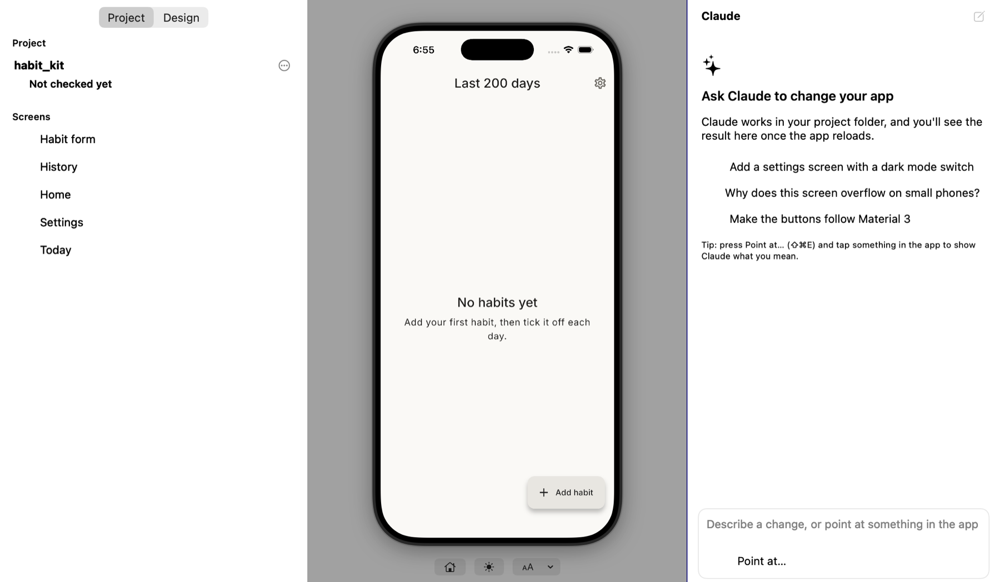

# AppFast Studio

An open-source macOS app for building Flutter apps with a coding agent, as an alternative to paid builders like
FlutterFlow and Dreamflow. Your project, a live simulator and an agent chat sit in one window: ask for a change,
watch it hot-reload, undo it if you don't like it. It runs the agent you already have, so you don't pay for a
second AI subscription.



> **Status:** early. Claude Code is the supported agent today. Codex, Antigravity CLI and bring-your-own-key
> are planned, and so are backend setup and publishing. See [Agents](#agents) and [Roadmap](#roadmap).

## Features

### Build and see it live

- **Live simulator in the window.** Boot any installed iOS Simulator and see its screen in the app, inside the
  real device frame. Click to tap, drag to swipe, type with your keyboard. There's no Simulator.app window and
  no screen-recording permission involved.
- **Run and Hot Reload, Xcode-style.** Pick a destination and press Run (⌘R). If the simulator is off, it boots
  first. Projects with flavors run the flavor you pick in the sidebar. The app also finds an app left running by
  an earlier run or a terminal and offers to reconnect.
- **Build log** under the device (⇧⌘Y), and a banner that says what to do when something goes wrong.
- **Preview settings.** Switch the simulator between light and dark, and change its text size, right under the device.
- **Android emulators.** Android Virtual Devices appear in the destination menu next to simulators, and the app
  can boot one and set its dark mode and font size. Showing the emulator's screen in the window is not built yet.

### Ask, see, undo

- **Ask in plain words.** The running app reloads on its own to show each change (a hot restart for start-up
  code and themes, a "Run Again" prompt for packages and native settings). Answers say what changed in the app
  first, with the technical details folded away. When the agent offers options, they appear as a card you pick from.
- **Undo, always.** Every change the agent makes is saved as a checkpoint and can be undone from the chat or the
  History list. Undo refuses to run if you've edited a file since, so it never overwrites your work. Changed
  files are listed from the disk itself, not from what the agent says it did.
- **Point at it.** Press **Point at…** (⇧⌘E) and tap something in the running app; a picture of it and its
  place in the code go with your next message.
- **Fix with Claude.** When a run fails, Claude finds the cause, makes the smallest fix, and the app runs
  again to check it.
- **The agent can look at the app.** It takes screenshots of the simulator, taps, swipes and types to check its own
  work before it says it's done.
- **You approve what's risky.** A command outside the allow-list asks first (Allow Once, Always Allow, Don't Allow).
  Deleting files, running as administrator, git writes and reading credentials are refused outright.

### Start a new app

- **New Flutter Project** (⌘N). Name it, choose an app ID and a folder; the app runs `flutter create`, adds a
  starter with routing and state management, and makes the first git commit. If a step fails, Retry picks up
  where it stopped.
- **Planning chat.** A short interview turns your idea into a plan (`PLAN.md`) with milestones. The sidebar
  tracks them as done, next and later, and **Build** turns the next one into code.

### See the whole app

- **Screens.** The sidebar lists the screens found in your code. Click one to ask about it.
- **App Flow.** A map of how the screens connect (Navigator, named routes, go_router, auto_route and tabs),
  drawn from your code. Pan and pinch to zoom; planned screens that aren't built yet show as dashed cards.
- **Design** (⌥⌘D). Mockups of every screen on a canvas, made by a design chat that can only write the
  `design/` folder. Pick a style, colour theme and Google Fonts pairing, compare several versions of a screen,
  redesign a screen that already exists from a screenshot, then **Apply to the App** or **Use this design** to
  turn the theme into code, fonts included.

### Stay in control of your code

- **Open in your editor.** Cursor, VS Code, Zed or Android Studio, at the right file and line, from a screen,
  a picked widget or a diff.
- **Edit by hand.** Any diff in History can be switched to Edit and saved. Hand edits show up in History and
  can be undone like the agent's.
- **History** lists every change, from the agent or from you, with a git diff for each file.
- **Several Claude accounts.** Add accounts in Settings and switch between them.

### Set up for you

- **Get Started checklist.** If Claude, Xcode, Flutter, CocoaPods or an iOS Simulator is missing, one button
  installs it. Downloads are checked against the publisher's checksum, and the only password prompt is macOS's own.

## Agents

| Agent | Status |
|---|---|
| Claude Code | Supported. Sign in with your Claude account, or with several. |
| Codex CLI | Planned |
| Antigravity CLI | Planned |
| Bring your own key | Planned. Use an API key from the provider you choose instead of a CLI login. |

Today every request runs through your own `claude` CLI, so what you already pay for Claude is what you pay.

## Roadmap

These are plans, not features yet:

- More agents, and bring your own key (see above).
- **A backend for the app.** Set up Appwrite or Firebase for it, or a custom backend when the app needs one.
- **Ready to publish.** Build, sign and ship to the App Store and Google Play.
- **The emulator's screen in the window,** so Android works like the iOS Simulator does.

## Requirements

- macOS 15 or later, and Xcode with an iOS Simulator runtime
- [Flutter](https://docs.flutter.dev/get-started/install/macos) on your `PATH`
- The [Claude Code CLI](https://docs.claude.com/en/docs/claude-code), signed in:
  ```bash
  curl -fsSL https://claude.ai/install.sh | bash
  ```
- [XcodeGen](https://github.com/yonaskolb/XcodeGen), to build from source:
  ```bash
  brew install xcodegen
  ```

The Get Started checklist installs everything except XcodeGen, so you only need to install tools by hand when building from source.

## Build and run

```bash
xcodegen generate
```

```bash
xcodebuild -project MobileStudio.xcodeproj -scheme MobileStudio build
```

Or open `MobileStudio.xcodeproj` in Xcode and press ⌘R. Run the tests with:

```bash
xcodebuild -project MobileStudio.xcodeproj -scheme MobileStudio test
```

`MobileStudio.xcodeproj` is generated from `project.yml`. Edit `project.yml`, not the project. The project and
source folders keep the name `MobileStudio` from before the app was renamed; the app is **AppFast Studio**.

## Using it

1. Follow **Get Started** in the sidebar: it checks the Claude CLI, your sign-in, Xcode, Flutter and the simulators.
2. Create a new project (⌘N) or choose an existing Flutter project (⌘O), the folder that contains `pubspec.yaml`.
3. Pick a simulator from the toolbar and press **Run** (⌘R).
4. Ask Claude for a change in the chat (⌥⌘0 shows it). Use **Point at…** (⇧⌘E) to show it what you mean. The app
   reloads by itself after each change, and **Undo** puts things back.

| Shortcut | Action |
|---|---|
| ⌘N / ⌘O | New project / open a Flutter project |
| ⌘R / ⌘. | Run / Stop |
| ⇧⌘R / ⌥⇧⌘R | Hot Reload / Hot Restart |
| ⇧⌘E | Pick an element in the running app |
| ⌘1 / ⌘2 | Device / App Flow |
| ⌥⌘D | Design |
| ⇧⌘Y | Show or hide the build log |
| ⌥⌘0 | Show or hide the chat |
| ⇧⌘N | New chat |
| ⌘+ / ⌘- / ⌘0 / ⌘9 | Zoom in / out / actual size / fit (App Flow) |

## How it works

| Area | Folder | Notes |
|---|---|---|
| App shell | `MobileStudio/App` | Composition root, `Workspace` (the main window's models, actions and the rules between them), menu commands |
| Views | `MobileStudio/Views` | SwiftUI, layout only |
| Project and run | `MobileStudio/Project` | Folder inspection, `flutter run`/`attach`, New Project, planning, file snapshots, hand edits |
| Chat | `MobileStudio/Chat` | Conversation per project folder, saved in Application Support |
| Claude CLI | `MobileStudio/ClaudeCLI` | Finding the CLI, account access, safe agent calls, approvals, parsing its event stream |
| Devices | `MobileStudio/Device`, `Simulator`, `Android` | One `DeviceService` per platform: `simctl` with an Objective-C bridge to CoreSimulator's framebuffer, and the Android emulator |
| Inspector | `MobileStudio/Inspector` | Pick, over the Dart VM service and Flutter's widget inspector |
| Design | `MobileStudio/Design` | Mockups, styles, colour themes, fonts, handing a design to the app |
| Setup | `MobileStudio/Setup` | Detecting and installing the tools the app needs |
| Core | `MobileStudio/Core` | Process running, logs, shell `PATH`, editor integration, shared extensions |

Read [AGENTS.md](AGENTS.md) for the architecture rules and conventions.

### Safety

AppFast Studio runs the agent with edit access to your project, so every call is restricted:

- It runs in safe mode, so your machine's plugins, skills, MCP servers and hooks stay off.
- Edits are limited to the project folder, and shell commands to an allow-list: `flutter pub/build/analyze/test`,
  `dart format/analyze/fix`, `pod`, and read-only `git`. Anything else asks you first, and some things are always
  refused (`rm`, `sudo`, nested shells, `flutter run`, git writes, credentials).
- Each call has a spending cap and a timeout.
- The project check is read-only, and the design chat can only write the `design/` folder.

The app is not sandboxed, because it has to run your `claude`, `flutter`, `xcrun` and `git`. The live simulator
view uses Apple's private CoreSimulator framework, so a new Xcode can break it. When it does, the app shows an
error rather than crashing.

### Logs

Every run, check, chat and fix writes the exact command and output to `~/Library/Logs/AppFast Studio/`. Each
failure in the app has a **Show log** button.

### Coming from Mobile Studio

The app used to be called Mobile Studio. On first launch it moves your chats, accounts and logs to the new
folders and keeps your settings, so nothing is lost.
